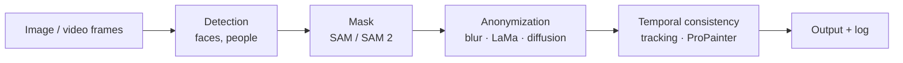

# Game Footage Anonymizer

Anonymizing sensitive data in game footage: from blurring to face and full-body inpainting in images and video.

> Status: **work in progress** (university computer vision project, 2026/27). Results and examples are added as each stage lands.

## Why

Screenshots, recordings and streams from games often contain things that should not be shared: a streamer's
facecam, photorealistic characters scanned from real people, player nicknames. Detecting them and putting a blur
on top is easy, but it looks bad, leaks the fact that something was hidden, and weak blur can be partially
reversed. This project goes further and uses **generative inpainting** so the anonymized frame looks natural.

## Two modes

| | Mode A: face | Mode B: full body |
| --- | --- | --- |
| Detection | Face detector (RetinaFace) | Person detector (Mask R-CNN) |
| Mask | SAM from the face box | SAM 2 from the person box, tracked in video |
| Anonymization | Blur / pixelation vs. inpainting (LaMa, Stable Diffusion) | Remove the person, inpaint the background (LaMa vs. diffusion, ProPainter for video) |
| Difficulty | Low, near real-time | High, offline GPU processing |

## Pipeline



## Roadmap

- [x] Stage 0: project skeleton, classic baselines (blur, pixelation, solid fill), basic metrics
- [ ] Stage 1: face detection on game frames + classic anonymization baseline
- [ ] Stage 2: face masks (SAM) + inpainting (LaMa, SD Inpainting), comparison with baseline
- [ ] Stage 3: full-body removal on images (Mask R-CNN + SAM 2 + LaMa vs. diffusion)
- [ ] Stage 4: full-body removal in video (SAM 2 tracking + ProPainter), temporal consistency
- [ ] Stage 5: fine-tuning on own game frames, demo, final report

Details in [docs/roadmap.md](docs/roadmap.md).

## Results

Coming with stage 1. Planned evaluation:

- **Detection / masks:** recall, precision, mAP, mask IoU (recall matters most: a missed face is a leak)
- **Inpainting:** LPIPS, FID, PSNR / SSIM where ground truth exists, user survey
- **Video:** temporal warping error (flicker), time per frame, VRAM

## Getting started

```bash
git clone https://github.com/Eragofix/game-footage-anonymizer.git
cd game-footage-anonymizer
python -m venv .venv && source .venv/bin/activate
pip install -r requirements.txt   # for GPU, install the CUDA build of torch first: https://pytorch.org
pip install -e .
pytest
```

Classic baseline on a single image (boxes given by hand until detectors land):

```bash
python scripts/anonymize_image.py frame.png out.png --box 100 50 220 190 --method pixelate
```

Datasets are not stored in the repo, see [data/README.md](data/README.md).

## Project structure

```
configs/        experiment configs (YAML)
data/           local datasets (git-ignored), see data/README.md
docs/           roadmap, report, presentations
notebooks/      exploration, Colab notebooks
results/        result tables (CSV) and selected showcase images
scripts/        entry points: data download, experiments, demos
src/anonymizer/
  detection/      face and person detectors
  segmentation/   SAM / SAM 2 masks
  anonymization/  classic baselines and generative inpainting
  video/          tracking, temporal consistency
  evaluation/     metrics
tests/          unit tests (run in CI)
```

## Authors

- **Jan Durawa** ([@Eragofix](https://github.com/Eragofix))
- **Wiktoria Jankowska**

Supervisor: dr inż. Magdalena Mazur-Milecka.

## References

Key methods: RetinaFace (Deng et al., CVPR 2020), SAM / SAM 2 (Kirillov et al., ICCV 2023; Ravi et al., 2024),
LaMa (Suvorov et al., WACV 2022), Latent Diffusion (Rombach et al., CVPR 2022), ProPainter (Zhou et al., ICCV 2023).
Game datasets: GTA-Human, SAIL-VOS, MOTSynth, JTA (see [data/README.md](data/README.md)).

Several of these models and datasets are licensed for **non-commercial research use only**; this project uses them
accordingly.
